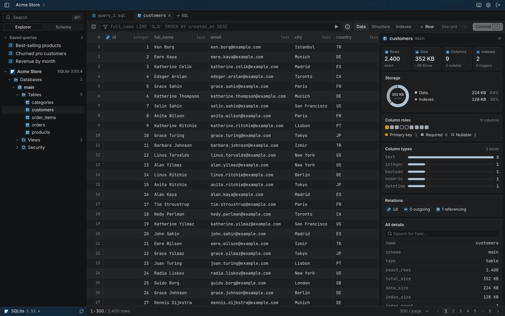
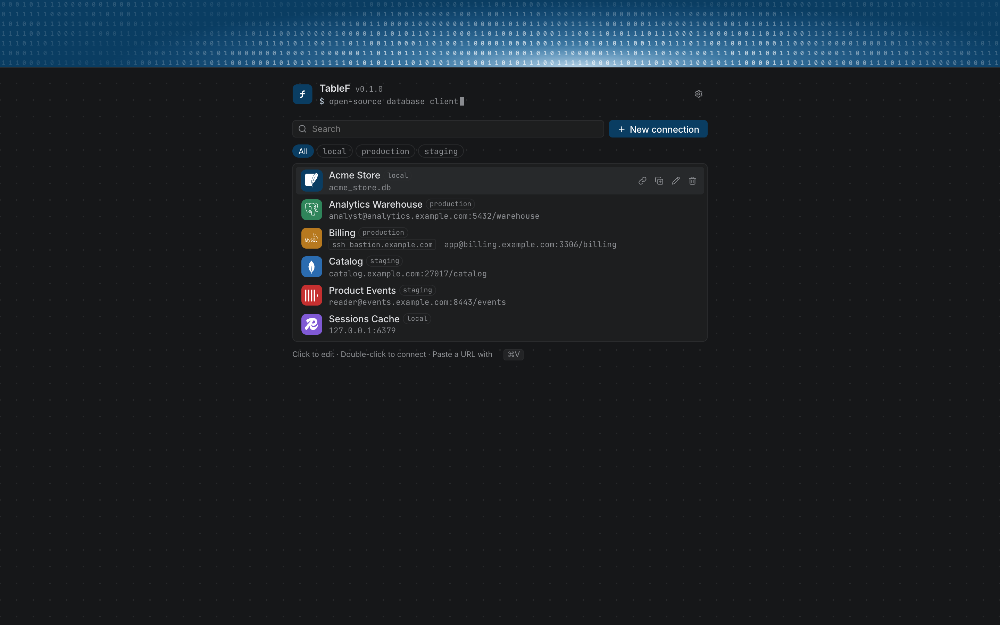
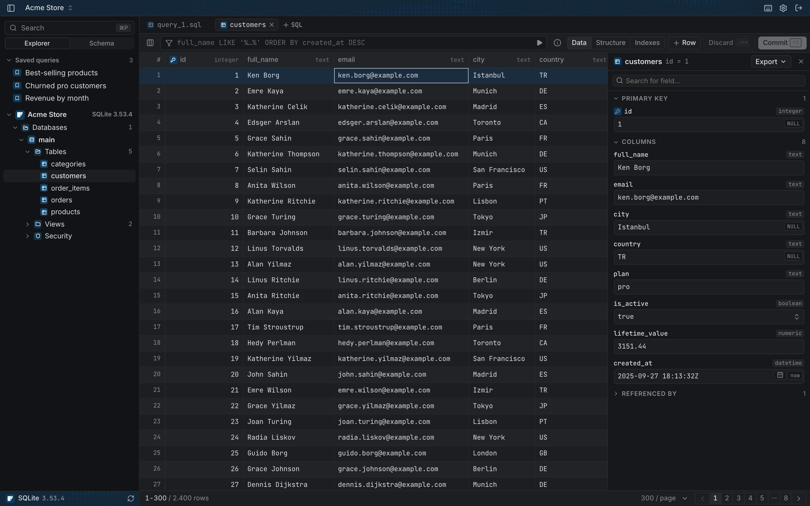
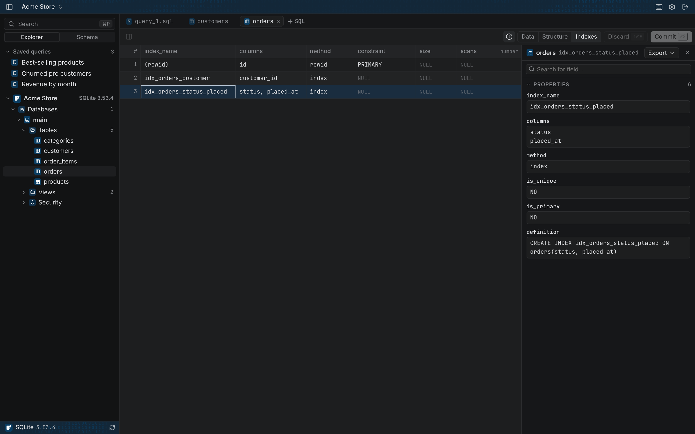
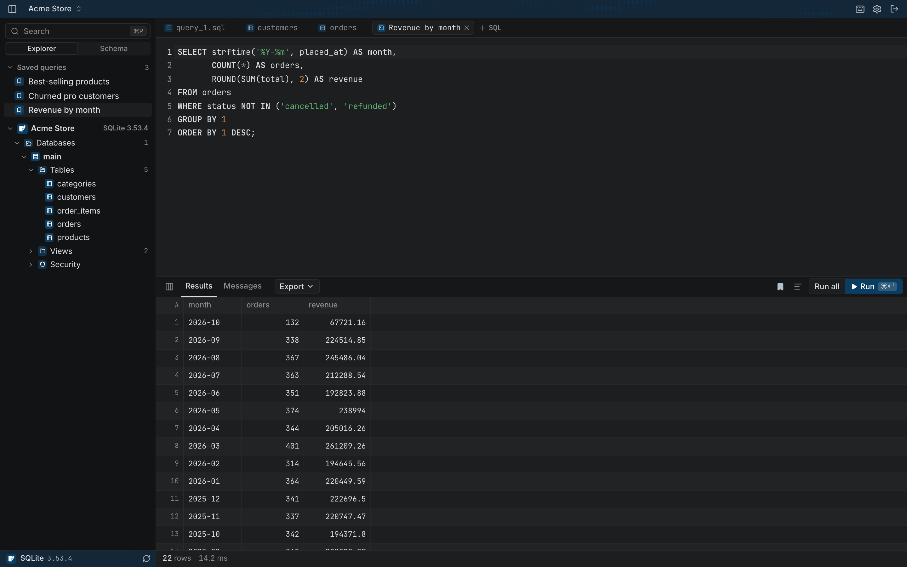

# TableF

A free and open-source database client for macOS, Windows, Linux and the browser.
One fast, keyboard-first interface for SQL and NoSQL databases.

TableF is a free alternative to **TablePlus** and **SQL Server Management
Studio (SSMS)**: the clean, native-feeling grid and editor of TablePlus, plus an
SSMS-style Object Explorer, index details and table statistics. It works with
22 databases, on every platform, and the code is open.



## Databases

| SQL | Cloud & distributed | NoSQL & search |
| --- | --- | --- |
| PostgreSQL | Amazon Redshift | MongoDB |
| MySQL | Snowflake | Redis |
| MariaDB & SingleStore | Google BigQuery | Elasticsearch |
| Microsoft SQL Server | Amazon DynamoDB | Cassandra |
| Oracle | Cloudflare D1 | |
| SQLite | LibSQL / Turso | |
| DuckDB | CockroachDB | |
| ClickHouse | Greenplum | |
| | Vertica | |

Any network database can be reached **over SSH** (agent, key file or password,
with `known_hosts` verification).

## Features

- Spreadsheet-like grid with virtual scrolling, inline editing, typed editors
  (booleans, date/time pickers, JSON, UUIDs), undo/redo and one-click commit.
- SQL editor with completion, formatting, run current / run all and editable
  results for single-table queries.
- Filters in the database's own language, server-side grouping, pinned and
  hidden columns, foreign-key navigation and a record detail pane.
- Table details at a glance: row count, size on disk, storage breakdown,
  row health and index usage, column roles and types.
- Structure and Indexes views, with sizes and scan counts where the engine
  reports them (unused indexes are flagged).
- SSMS-style Object Explorer: every database with its tables, views,
  procedures, functions, users, roles and schemas.
- Saved queries per connection, a right-click menu for tables and routines
  (select top N, count, copy scripts, clone, truncate, drop).
- Export to Markdown, JSON, CSV and Excel.
- Tabs and split panes, connection tags and colors, import from a connection URL.

## Screenshots

All screenshots use a fictional store database; none of the data is real.

| | |
| --- | --- |
|  |  |
| **Connections**: tags, colors and SSH at a glance. | **Records**: typed editors for every column. |
|  |  |
| **Indexes**: columns, type, size, scans and definition. | **Queries**: saved per connection, editable results. |

## Download

| Platform | Download |
| --- | --- |
| macOS 13+ (Apple silicon & Intel) | [TableF-macos-universal.zip](https://github.com/mdenesfe/TableF/releases/latest/download/TableF-macos-universal.zip) |
| Windows 10/11 (x64) | [TableF-windows-amd64.zip](https://github.com/mdenesfe/TableF/releases/latest/download/TableF-windows-amd64.zip) |

All versions and release notes are on the [releases page](https://github.com/mdenesfe/TableF/releases).
The apps are not code-signed yet:

- **macOS:** unzip, move TableF to Applications, then right-click it and
  choose **Open** the first time.
- **Windows:** unzip and run `TableF.exe`. If SmartScreen appears, choose
  **More info → Run anyway**.

Linux users can build from source (below) or run the web version.

## Getting started

### Desktop app

Requires [Go](https://go.dev) 1.26+, [Node.js](https://nodejs.org) 22+,
[pnpm](https://pnpm.io) and the [Wails CLI](https://wails.io).

```bash
wails build          # the app ends up in build/bin
wails dev            # development mode with hot reload
```

Release builds for macOS (universal) and Windows are produced by
`.github/workflows/release.yml` when a `v*` tag is pushed. The apps are not
code-signed yet: on macOS, right-click the app and choose **Open** the first
time; on Windows, choose **More info → Run anyway** in SmartScreen.

DuckDB embeds a C++ library and is only included in cgo builds. Cross-compiling
for Windows from macOS without a mingw toolchain (`CGO_ENABLED=0`) leaves it
out; the release workflow builds on Windows itself, so DuckDB is included there.

### Web version

```bash
cd frontend && pnpm install && pnpm build && cd ..
go run ./cmd/tablef-web          # http://127.0.0.1:7070
```

Flags (or environment variables):

| Flag | Env | Default | |
| --- | --- | --- | --- |
| `-addr` | `TABLEF_ADDR` | `127.0.0.1:7070` | Listen address |
| `-token` | `TABLEF_TOKEN` | | Require this bearer token for API calls |
| `-store` | `TABLEF_STORE` | user config dir | Saved connections file |

Set a token whenever the server listens on anything other than localhost.

## Project layout

```
main.go                 desktop entry point (Wails)
cmd/tablef-web/         web server entry point
internal/core/          application service shared by desktop and web
internal/driver/        engine contracts (SQL drivers and non-SQL stores)
internal/engines/       one package per database engine
internal/tunnel/        SSH tunnels
internal/web/           HTTP/RPC server for the web version
frontend/               SvelteKit UI (embedded into both builds)
```

Each engine registers itself from `init()`. A SQL engine implements
`driver.Driver` plus optional hooks (`Paginator`, `Versioner`, `Featurer`, …);
a non-SQL engine implements `driver.Store`. See `internal/driver` for the
contracts and `CONTRIBUTING.md` for how to add one.

## Development

```bash
go test ./...                    # backend tests
cd frontend
pnpm check                       # type checking
pnpm test                        # unit tests
pnpm format                      # formatting
```

## License

[MIT](LICENSE)
